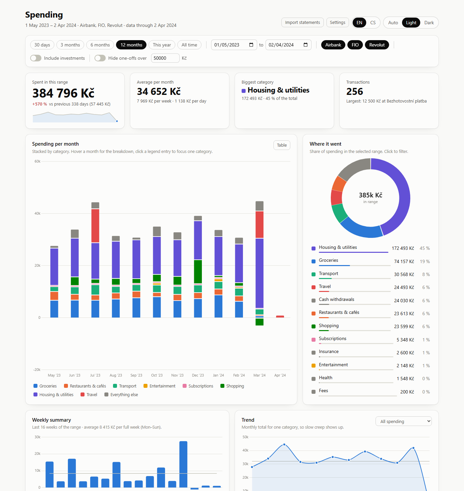

# Bank Statement Dashboard

An offline spending dashboard for your bank statement exports. Drop the files onto the page and
see where your money goes: by month, by category, by week, with a searchable transaction list.
Everything runs in your browser. There is no server, no account and no bank login.

**[Try the demo](https://slamartin.github.io/ExpenseTracker/)** with made-up data, or open
**[the dashboard](https://slamartin.github.io/ExpenseTracker/dashboard.html)** and save it to use
offline.



Czech banks come first: **FIO banka**, **Air Bank** and **Revolut** (Czech or English export).
The interface is in English and Czech. Parsers for other banks are welcome, see
[CONTRIBUTING.md](CONTRIBUTING.md).

## Privacy

- Your statements are read by the page itself, in your browser. Nothing is uploaded anywhere.
- The page makes no network requests at all. It also works with the network turned off.
- Imported transactions are stored in this browser's local storage (IndexedDB) so they are still
  there next time. **Settings → Forget my data** removes them.
- The code is short and has no dependencies beyond two vendored libraries (Chart.js and pdf.js),
  so you can read what it does.

## Use it

1. Get the dashboard, a single file named `dashboard.html`. Save it from
   [the project site](https://slamartin.github.io/ExpenseTracker/dashboard.html), or build it
   yourself (see Development below).
2. Open it in a current browser; double-clicking the file is enough. It is tested in Chrome and
   Edge.
3. Export your statements from internet banking (see below) and drop them onto the page, or click
   **Import statements**. You can drop several files at once, and importing the same file twice
   adds nothing.
4. Open **Settings** and enter your own account numbers. Money moved between your own accounts
   is then not counted as spending. Add the accounts of brokers or savings products as
   investment accounts, and the accounts you pay rent or utilities to as category accounts.

[The demo](https://slamartin.github.io/ExpenseTracker/) runs the same dashboard on made-up data,
and nothing you import there is saved.

## Supported banks

| Bank | File | How to get it |
|---|---|---|
| FIO banka | CSV | In internet banking, open the account movements ("Pohyby na účtu"), pick the period and export as CSV. One export can cover all your FIO accounts. |
| Air Bank | PDF statement | Download the statement PDF in internet banking. For a long history, ask for an extraordinary statement ("mimořádný výpis") covering the whole period. The page checks the parsed total against the total printed on the statement. |
| Revolut | CSV | In the app, request an account statement for the period in the spreadsheet (CSV) format. Czech and English exports both work. |

The file type is recognized from its name and content, so renamed files still import.

## How transactions are sorted

1. Transfers between your own accounts and incoming money are not spending.
2. Payments to investment accounts are investments, hidden unless **Include investments** is on.
3. Everything else is spending. Its category comes from the counterparty account if you assigned
   one in Settings, otherwise from keywords (for example "billa" means Groceries).
4. What no rule recognizes lands in **Other**. The "Not categorized yet" panel lists the biggest
   ones; pick a category there and it applies to every transaction with that merchant.

Refunds are netted against their category. Foreign currencies are converted at fixed rates you
can change in Settings. The keyword rules live in a JSON file you can export, edit and import
again in Settings.

## Development

Node 22 or newer. No packages to install. The browser tests need Chrome or Edge.

```
node --test "tests/*.test.mjs"                          # tests, browser tests included
node scripts/serve.mjs                                  # http://localhost:8080/?demo=1
node scripts/build.mjs                                  # dist/dashboard.html
node scripts/build.mjs --with-samples --out dist/demo.html
node scripts/render-check.mjs dist/dashboard.html       # headless smoke test
```

The source is plain JavaScript modules under `src/`. `scripts/build.mjs` bundles them, the styles
and the vendored libraries into one HTML file that works from `file://`. The sample statements in
`samples/` are generated by `scripts/make-samples.mjs` and contain only fictional data.

## Limitations

- Air Bank is read from the PDF statement only; its CSV export is not supported yet.
- Currency rates are fixed, not historical.
- Category names are not translated, because they are part of your rules.
- Firefox and Safari are expected to work but are not covered by the automated tests, which run
  in Chrome and Edge.

## Credits and license

Chart.js (MIT) draws the charts. pdf.js (Apache-2.0, Mozilla) reads the Air Bank PDF statements.
Both are vendored unmodified; versions are listed in `vendor/VERSIONS.md`.

The project is released under the MIT license, see [LICENSE](LICENSE).
